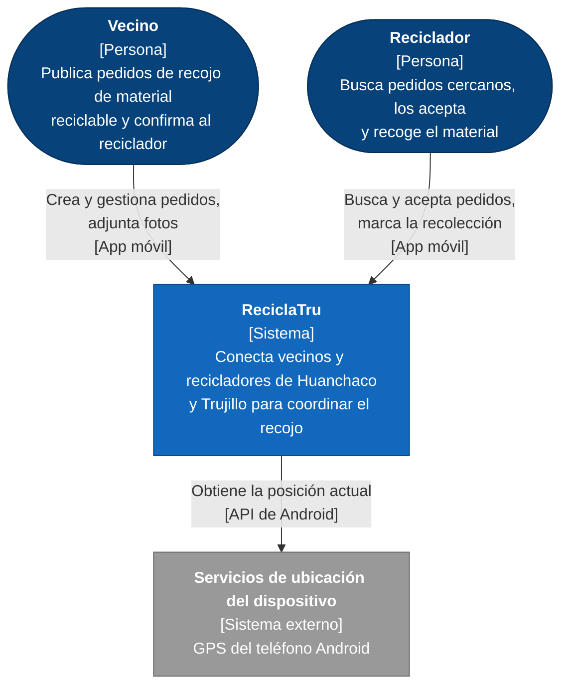
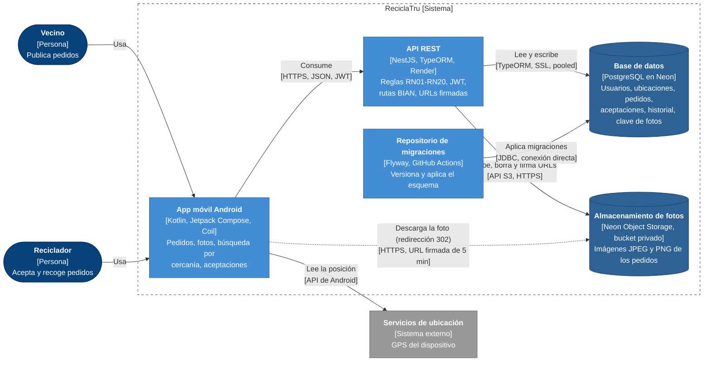
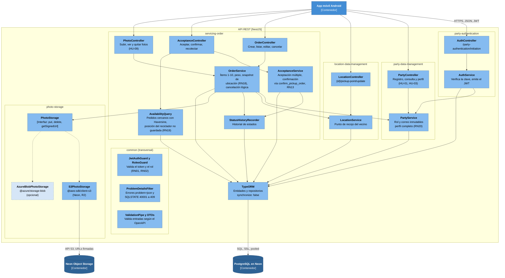

# ReciclaTru: arquitectura C4 (niveles 1 y 2)

Modelo C4 de la iniciativa. Los diagramas están en Mermaid (`flowchart` con estilo C4) y se ven directamente en GitHub, GitLab y la mayoría de visores de Markdown.

## Nivel 1: Contexto del sistema

Muestra quién usa ReciclaTru y con qué sistemas externos se relaciona.

**Notas**

- Hay dos tipos de usuario y cada cuenta tiene un único rol (RN01).
- La posición del reciclador se usa solo para buscar pedidos cercanos y no se guarda (RN19).
- La dirección exacta del vecino solo es visible para el reciclador elegido, con el pedido confirmado (RN13).
- Por ahora no hay otros sistemas externos de negocio (pagos, mensajería, notificaciones push): son ampliaciones del Release 2.

## Nivel 2: Contenedores

Muestra las piezas desplegables y cómo se comunican.

## Contenedores

| Contenedor | Tecnología | Responsabilidad | Despliegue |
|---|---|---|---|
| App móvil Android | Kotlin, Jetpack Compose, Coil | Interfaz de vecino y reciclador; comprime fotos a ~300 KB; sigue la redirección 302 para mostrar fotos; usa el GPS para buscar pedidos cercanos | Dispositivo del usuario |
| API REST | NestJS, TypeORM (`synchronize: false`) | Valida las reglas de negocio, autentica con JWT, sirve las rutas BIAN, valida y sube las fotos, responde 302 hacia URLs firmadas | Render (Azure en evaluación) |
| Base de datos | PostgreSQL (Neon) | Persistencia, ENUM nativos, índices parciales, función `confirm_pickup_order`, cálculo Haversine | Neon, proyecto `reciclatru`, AWS US East 2 |
| Almacenamiento de fotos | Neon Object Storage (S3), bucket privado | Guarda las imágenes; la base solo guarda la clave | Mismo proyecto de Neon |
| Repositorio de migraciones | Flyway, GitHub Actions | Versiona y despliega el esquema; el backend no lo modifica | Repositorio `reciclatru-db` |

## Protocolos y seguridad

- **App → API:** HTTPS; `Authorization: Bearer <accessToken>`; JSON y `multipart/form-data` para las fotos.
- **API → base de datos:** cadena **pooled** de Neon, SSL obligatorio. Una violación de serialización (SQLSTATE 40001) se traduce a `409`.
- **Migraciones → base de datos:** cadena **directa** (sin `-pooler`), porque Flyway usa bloqueos de sesión. Las credenciales viven como secretos del environment `production` en GitHub.
- **API → almacenamiento:** API S3 con credenciales de lectura y escritura, solo como secretos de Render.
- **App → almacenamiento:** solo mediante URL firmada de corta duración que entrega el API en una redirección 302. La app nunca recibe una URL permanente ni credenciales.

## Decisiones reflejadas

1. **Base de datos y fotos en el mismo proveedor (Neon):** una cuenta, un conjunto de credenciales y una región.
2. **Esquema versionado fuera del backend:** el repositorio de migraciones es independiente; el backend no ejecuta migraciones.
3. **Fotos fuera del servidor:** el disco de Render es efímero; la base guarda solo la clave del objeto.
4. **Interfaz `PhotoStorage` dentro del API:** permite pasar a Cloudflare R2 o Azure Blob con una variable de entorno.
5. **Monolito modular en el API:** una sola unidad desplegable, con módulos por dominio BIAN. Es lo adecuado para un equipo de 7 y para el plazo del curso.

## Pendientes y supuestos

- **Servicios de ubicación:** se asume el GPS del dispositivo para HU de búsqueda por cercanía. Si el informe prevé mapas o navegación (por ejemplo, abrir Google Maps), se añade como sistema externo.
- **Alojamiento del API:** Render por ahora. Si se aprueba la cuenta educativa de Azure, solo cambia el despliegue del contenedor API.
- **Notificaciones push (FCM)** y el **refresh token** (tabla `auth_session`) no están en este diagrama: se añaden en el Release 2.
- El estado de Neon Object Storage (preview o estable) no está indicado en su documentación; conviene revisarlo antes de depender de él más allá del curso.

## Nivel 3: Componentes del API REST

Descompone el contenedor **API REST** (NestJS) en sus módulos. Cada módulo de NestJS es un componente y sigue el patrón controller, service y repository (TypeORM). Las flechas indican dependencias entre módulos.

**Lectura del diagrama**

- Los guards, el filtro de errores y los pipes de `common` se aplican globalmente a todos los controladores; no se dibujan flechas para no saturar.
- `servicing-order` es el módulo central: concentra las reglas de pedidos, aceptaciones y ubicación (hasta RN18). La confirmación del reciclador no se hace en memoria: `AcceptanceService` delega en la función `confirm_pickup_order` de la base, que es atómica y evita que dos vecinos o dos recicladores confirmen el mismo pedido.
- `photo-storage` expone solo la interfaz `PhotoStorage`; el proveedor concreto se elige con `STORAGE_DRIVER`. `servicing-order` nunca conoce el SDK de S3 ni el de Azure.
- Un módulo solo depende de los servicios públicos de otro, no de sus repositorios, para poder separarlos más adelante si hiciera falta.

## Nivel 4: Código (no se dibuja)

El modelo C4 lo define como opcional. Para ReciclaTru no se recomienda dibujarlo a mano, porque se desactualiza con cada commit. En su lugar:

- Diagrama de secuencia de la **confirmación del reciclador** (RN13, `confirm_pickup_order`, respuesta `409`).
- Diagrama de secuencia de la **subida y lectura de fotos** (bucket, clave del objeto, 302 a URL firmada).
- El detalle de entidades ya está en `docs/data-model.md`.

Si el curso exige un nivel 4, puede ser un diagrama de clases UML solo del módulo `servicing-order`.
