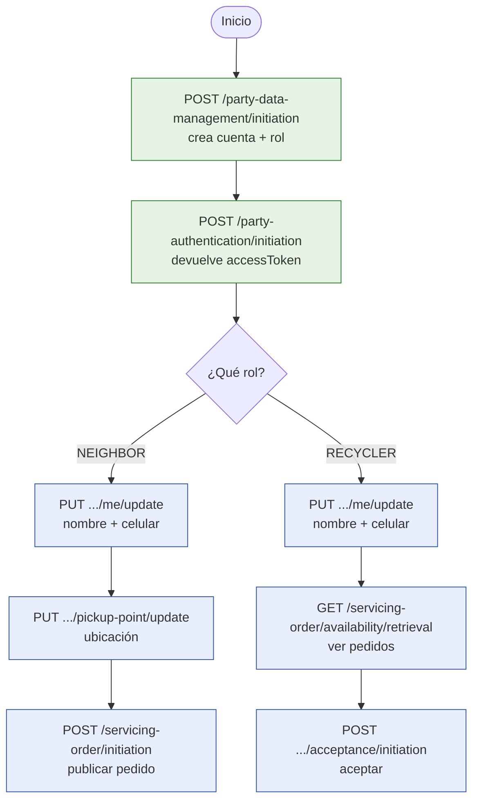
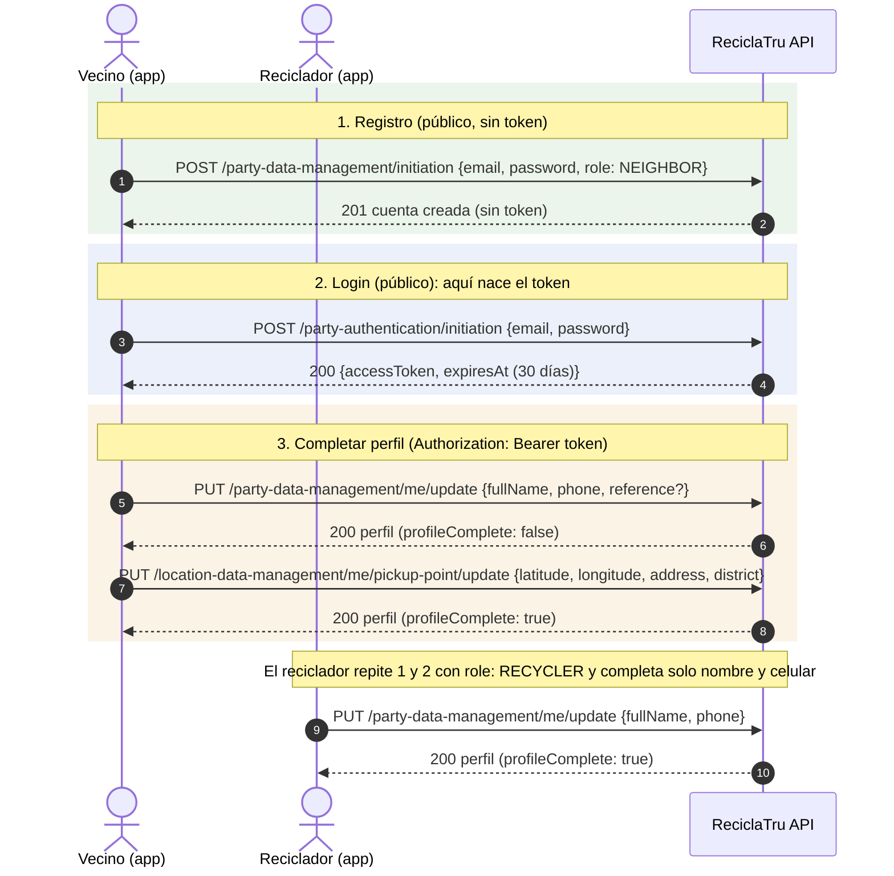
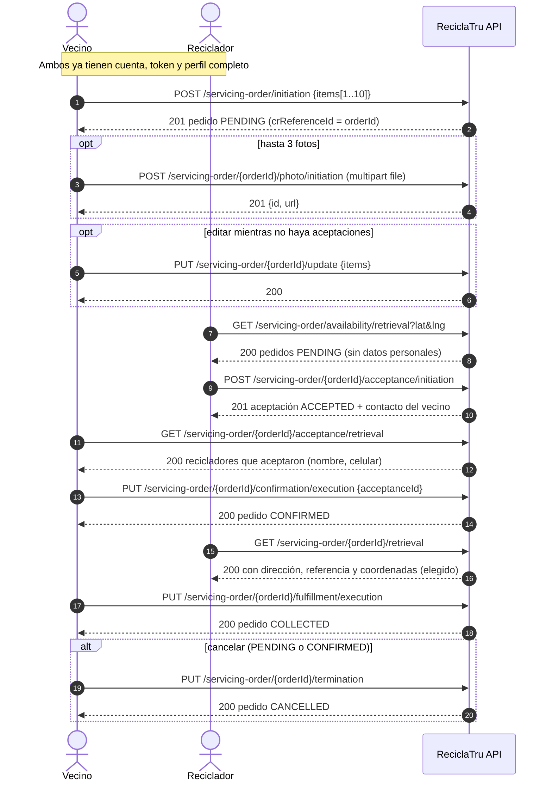

# ReciclaTru API: orden de invocación de los endpoints

Respuesta corta: **primero se registra la cuenta (con su rol), después se hace login y ahí nace el token.** El login no crea nada: solo valida que la cuenta existe.

Rutas con prefijo `/api/v1`. Los endpoints marcados como públicos no llevan token; todos los demás requieren `Authorization: Bearer <accessToken>`.

## 1. Flujo de arranque (resuelve el 401 con la tabla vacía)

| Paso | Endpoint | Token | Qué hace |
|---|---|---|---|
| 1 | `POST /party-data-management/initiation` | No | Crea la cuenta con `email`, `password` y `role` (`NEIGHBOR` o `RECYCLER`). Responde 201 **sin token**. |
| 2 | `POST /party-authentication/initiation` | No | Valida correo y contraseña y devuelve `accessToken` (30 días). Con la cuenta inexistente responde 401. |
| 3 | `PUT /party-data-management/me/update` | Sí | Nombre y celular (el vecino puede agregar `reference`). |
| 4 | `PUT /location-data-management/me/pickup-point/update` | Sí (vecino) | Punto de recojo. Con esto el perfil del vecino queda completo. |

Reglas útiles:

- Un solo rol por cuenta y no se puede cambiar. Para probar las dos caras, crea dos cuentas con correos distintos.
- Para publicar pedidos, el vecino necesita nombre, celular **y** ubicación (si no, 422 `PROFILE_INCOMPLETE`). El reciclador necesita nombre y celular para aceptar.

## 2. Secuencia de registro, login y perfil

## 3. Secuencia completa de un pedido

## 4. Estados del pedido

`PENDING` → `CONFIRMED` (el vecino elige un reciclador) → `COLLECTED` (el vecino marca recolectado). Desde `PENDING` o `CONFIRMED` se puede pasar a `CANCELLED`. `COLLECTED` y `CANCELLED` son finales.

## 5. Errores frecuentes

| Respuesta | Causa típica |
|---|---|
| 401 `UNAUTHENTICATED` en el login | La cuenta no existe (falta el registro) o la contraseña es incorrecta. |
| 401 en cualquier otro endpoint | Falta el encabezado `Authorization: Bearer ...`, o el token venció o está alterado. |
| 403 `FORBIDDEN_ROLE` | El endpoint es de otro rol (por ejemplo, un reciclador publicando un pedido). |
| 422 `PROFILE_INCOMPLETE` | Falta completar nombre, celular o (vecino) la ubicación. |
| 409 | El pedido ya cambió de estado (aceptado, confirmado, cancelado). |
