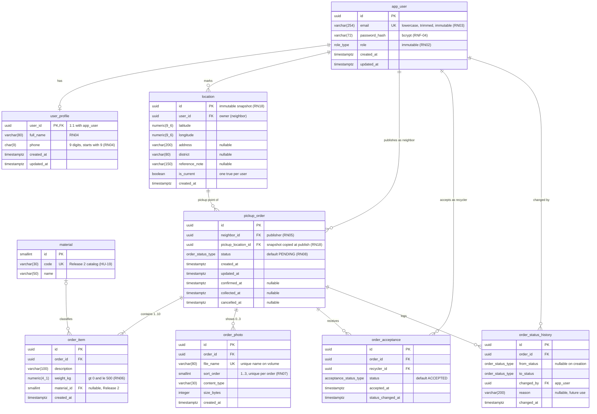

# ReciclaTru: modelo de datos (Release 1)

Base de datos: PostgreSQL. Backend: NestJS con TypeORM. Naming en inglés, `snake_case`, tablas en singular. La tabla de pedidos se llama `pickup_order` porque `order` es palabra reservada.

Los estados y el rol son **tipos `ENUM` de PostgreSQL** (sección 2). Solo `material` es una tabla de catálogo.

## 1. Diagrama entidad-relación

Nota de lectura: `numeric(9_6)` y `numeric(4_1)` equivalen a `numeric(9,6)` y `numeric(4,1)`; Mermaid no admite la coma en el tipo.

## 2. Tipos enumerados

| Tipo | Valores | Usado en |
|---|---|---|
| `role_type` | `NEIGHBOR`, `RECYCLER` | `app_user.role` |
| `order_status_type` | `PENDING`, `CONFIRMED`, `COLLECTED`, `CANCELLED` | `pickup_order.status`, `order_status_history.from_status` y `to_status` |
| `acceptance_status_type` | `ACCEPTED`, `CHOSEN`, `DISCARDED` | `order_acceptance.status` |

Transiciones del pedido: `PENDING → CONFIRMED → COLLECTED`; desde `PENDING` o `CONFIRMED` se puede pasar a `CANCELLED`. `COLLECTED` y `CANCELLED` son finales (esta marca vive como constante en el servicio).

Transiciones de la aceptación: `ACCEPTED → CHOSEN` o `ACCEPTED → DISCARDED`.

## 3. Restricciones que el diagrama no puede dibujar

| Restricción | Implementación |
|---|---|
| Una aceptación por reciclador y pedido (RN09, RNF-05) | `UNIQUE (order_id, recycler_id)` en `order_acceptance` |
| Un solo reciclador elegido por pedido (RN12, RNF-05) | Índice único parcial: `UNIQUE (order_id) WHERE status = 'CHOSEN'` |
| Máximo 3 fotos por pedido (RN07) | `CHECK (sort_order BETWEEN 1 AND 3)` y `UNIQUE (order_id, sort_order)` |
| Peso por ítem (RN06) | `CHECK (weight_kg > 0 AND weight_kg <= 500)` |
| Entre 1 y 10 ítems por pedido (RN06) | Trigger para el máximo; el mínimo de 1 lo valida el servicio al publicar |
| Una ubicación vigente por vecino | Índice único parcial: `UNIQUE (user_id) WHERE is_current` en `location` |
| La ubicación del pedido es del mismo vecino | Clave foránea compuesta `(pickup_location_id, neighbor_id)` → `location (id, user_id)` |
| Celular válido (RN04) | `CHECK (phone ~ '^9[0-9]{8}$')` |
| Correo único en minúsculas (RN03) | `UNIQUE` sobre `lower(email)` y `CHECK (email = lower(btrim(email)))` |
| Rol y correo inmutables (RN02, RN03) | Trigger que bloquea el `UPDATE` |
| Ubicación inmutable (RN18) | Trigger: solo puede cambiar `is_current` |
| Solo vecinos publican y solo recicladores aceptan (RN05) | Triggers de validación de `role` |
| Aceptar solo con el pedido `PENDING` (RN09) | Trigger con bloqueo de fila; error `ORDER_NOT_AVAILABLE` → la API responde `409` |
| Elegir reciclador de forma atómica (RN12) | Función `confirm_pickup_order(...)` |
| Pedidos no se borran (RN16) | Sin `DELETE`; la cancelación cambia `status` y `cancelled_at` |

## 4. Cómo cubre las reglas de negocio

| Regla | Dónde se resuelve |
|---|---|
| RN01 | `app_user` + JWT; sin tabla extra |
| RN02 | `app_user.role` (uno por cuenta, inmutable) |
| RN03 | `app_user.email` único e inmutable |
| RN04 | `user_profile.full_name` y `phone`, ambos `NOT NULL` |
| RN05 | `pickup_order.neighbor_id`; `order_acceptance.recycler_id`; triggers de rol |
| RN06 | `order_item` con sus `CHECK` y el límite de 10 |
| RN07 | `order_photo` con `sort_order` entre 1 y 3 |
| RN08 | `pickup_order.status` por defecto `PENDING` |
| RN09 | `order_acceptance` con `UNIQUE (order_id, recycler_id)` |
| RN10 | Derivada: se calcula con `order_acceptance.status` + `pickup_order.status`, sin columnas propias |
| RN11 | Derivada: editable si el pedido es `PENDING` y no tiene filas en `order_acceptance` |
| RN12 | Índice único parcial en `CHOSEN`; las demás pasan a `DISCARDED` en la misma transacción |
| RN13 | `pickup_order.pickup_location_id`; el API solo expone `location` al reciclador elegido con el pedido `CONFIRMED` |
| RN14 | No existen tablas de precios, pagos ni chat |
| RN15 | `pickup_order.collected_at` y estado `COLLECTED` (final, sin retorno) |
| RN16, RN17 | Borrado lógico: `CANCELLED` + `cancelled_at`; un pedido cancelado no se reabre |
| RN18 | `location` inmutable; cada pedido apunta a su fila. Si el vecino cambia su punto se crea otra fila y la anterior deja de ser `is_current` |
| RN19 | No existe tabla: la ubicación del reciclador llega como parámetro y no se persiste |
| RN20 | Derivada: reciclador con fila en `user_profile`; vecino con fila en `user_profile` y una `location` con `is_current = true` |

## 5. Alineación con el OpenAPI v1.0

Los valores de los `enum` del OpenAPI (`NEIGHBOR`, `RECYCLER`, `PENDING`, `CONFIRMED`, `COLLECTED`, `CANCELLED`, `ACCEPTED`, `CHOSEN`, `DISCARDED`) coinciden uno a uno con los tipos de PostgreSQL, así que no hay traducción entre el API y la base.

| Operación | Tablas involucradas |
|---|---|
| `POST /party-data-management/initiation` | `app_user` |
| `POST /party-authentication/initiation` | `app_user`, `user_profile` |
| `PUT /party-data-management/{id}/update` | `user_profile` |
| `PUT /location-data-management/{id}/pickup-point/update` | `location` |
| `POST /servicing-order/initiation` | `pickup_order`, `order_item`, `location`, `order_status_history` |
| `GET /servicing-order/retrieval` | `pickup_order`, `order_acceptance` (conteo), `order_photo` (miniatura) |
| `GET /servicing-order/availability/retrieval` | `pickup_order`, `location` (Haversine), `order_item` (peso total) |
| `GET /servicing-order/{id}/retrieval` | Todas las del pedido; los campos varían según rol y estado |
| `PUT /servicing-order/{id}/update` | `order_item`, `order_photo` |
| `POST/GET/PUT .../photo/...` | `order_photo` |
| `POST /servicing-order/{id}/acceptance/initiation` | `order_acceptance` |
| `GET /servicing-order/{id}/acceptance/retrieval` | `order_acceptance`, `user_profile` |
| `PUT /servicing-order/{id}/confirmation/execution` | `order_acceptance`, `pickup_order`, `order_status_history` |
| `GET /servicing-order/acceptance/retrieval` | `order_acceptance`, `pickup_order` (genera `acceptanceLabel`) |
| `PUT /servicing-order/{id}/fulfillment/execution` | `pickup_order`, `order_status_history` |
| `PUT /servicing-order/{id}/termination` | `pickup_order`, `order_status_history` |

## 6. Puntos de extensión (Release 2 y posteriores)

| Funcionalidad | Cambio necesario |
|---|---|
| Vencimiento a 72 h (HU-23), cancelación a 7 días (HU-25) | `ALTER TYPE order_status_type ADD VALUE 'EXPIRED'` y un job que escribe en `order_status_history` |
| Retirar aceptación (HU-27) | `ALTER TYPE acceptance_status_type ADD VALUE 'WITHDRAWN'` |
| Catálogo de materiales (HU-19) | Ya existe `material`; volver `order_item.material_id` obligatorio |
| Reabrir pedido (HU-26) | Solo reglas: la historia queda en `order_status_history` |
| Tope de aceptaciones (HU-24) | Conteo sobre `order_acceptance`, o columna `max_acceptances` en `pickup_order` |
| Verificar teléfono (HU-18) | Columna `phone_verified_at` en `user_profile` |
| Recuperar contraseña (HU-17) | Tabla `password_reset_token` (`id`, `user_id`, `token_hash`, `expires_at`, `used_at`) |
| Refresh token | Tabla `auth_session` (`id`, `user_id`, `token_hash`, `expires_at`, `revoked_at`) |
| Avisos push (HU-22) | Tabla `device_token` (`id`, `user_id`, `token`, `platform`) |
| Calificaciones y reportes | Tablas `rating` y `report` que referencian `pickup_order` y `app_user` |
| Nuevos roles | `ALTER TYPE role_type ADD VALUE ...` (o pasar `role` a tabla si los roles necesitan permisos) |

Con `ENUM`, agregar un valor es simple, pero **quitar o renombrar uno no es posible directamente** en PostgreSQL. Si se espera que los estados cambien con frecuencia, ese es el costo de esta decisión. Además, el valor agregado no se puede usar en la misma transacción que lo crea, así que el `ADD VALUE` debe ir en su propia migración.

## 7. Implementación con NestJS y TypeORM

- **`synchronize: false`** siempre, y sin `migrationsRun`. El esquema lo crea y versiona **Flyway** desde este repositorio (`reciclatru-db`); el backend solo lo usa, nunca lo modifica.
- **Triggers, funciones e índices parciales** viven en las migraciones SQL de Flyway. Las entidades de TypeORM solo los reflejan donde se puede (por ejemplo `@Index(['userId'], { unique: true, where: '"is_current"' })`) y deben coincidir con el esquema.
- **Enums:** declarar las columnas con `type: 'enum'` y `enumName` igual al tipo existente (`order_status_type`), para que TypeORM reutilice el tipo en lugar de crear otro.
- **`numeric` llega como `string`** desde el driver `pg`. Las columnas `weight_kg`, `latitude` y `longitude` necesitan un `transformer` a `number`.
- **Naming:** usar una estrategia `snake_case` (por ejemplo `SnakeNamingStrategy` del paquete `typeorm-naming-strategies`) para que las propiedades en `camelCase` mapeen a las columnas.
- **Transacciones:** aceptar y confirmar deben ejecutarse en transacción y mapear los errores `ORDER_NOT_AVAILABLE` y `ORDER_NOT_PENDING` (SQLSTATE `40001`) a `409 Conflict`.
- **Git y Flyway:** las migraciones se versionan en el repositorio propio `reciclatru-db`, una por cambio, con el nombre `V<AAAAMMDD_HHMM>__descripcion.sql`. Nunca se edita una migración ya aplicada: cada cambio de esquema es una migración nueva. Los cambios deben ser compatibles hacia atrás con el backend desplegado (por ejemplo, una columna nueva entra como nullable).

## 8. Decisiones de diseño

1. **Estados y rol como `ENUM`.** Alineados con el OpenAPI, sin ids numéricos en el esquema, y los valores se leen directo en las consultas.
2. **`location` inmutable.** Resuelve RN18 sin copiar columnas al pedido: el pedido apunta a la fila vigente al publicarse, y los cambios posteriores del vecino no lo afectan. La referencia (`reference_note`) viaja con la ubicación; editarla crea una fila nueva.
3. **`user_profile` separado de `app_user`.** El registro (HU-01) solo crea la cuenta; el perfil existe recién tras HU-03, así que `full_name` y `phone` pueden ser `NOT NULL`.
4. **Sin columnas derivadas.** El peso total, el conteo de aceptaciones, la etiqueta de HU-14, la completitud del perfil y la distancia se calculan en consultas.
5. **Reciclador elegido sin columna extra.** Se identifica por la aceptación en `CHOSEN`, garantizada como única por el índice parcial. Evita una referencia circular entre `pickup_order` y `order_acceptance`.
6. **`order_status_history`.** Auditoría de cada cambio de estado. El Release 1 no la expone en el API, pero soporta los vencimientos, la reapertura y los reportes del Release 2.
7. **Claves `uuid`** para las entidades de negocio y `smallint` para `material`.
